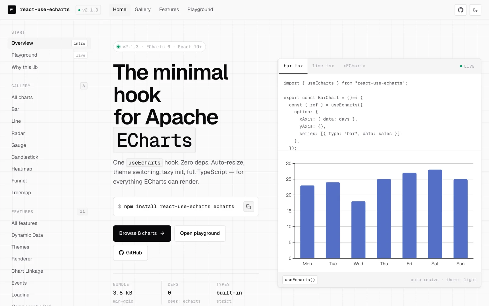

# react-use-echarts

> [中文](./README-zh_CN.md) | [English](./README.md)

[](https://www.npmjs.com/package/react-use-echarts)
[](https://www.npmjs.com/package/react-use-echarts)
[](https://github.com/chensid/react-use-echarts/actions/workflows/ci.yml)
[](https://codecov.io/gh/chensid/react-use-echarts)
[](https://github.com/chensid/react-use-echarts/blob/main/LICENSE.txt)
[](https://bundlephobia.com/package/react-use-echarts)

React hooks & component for Apache ECharts — TypeScript, auto-resize, themes, lazy init.

**[📊 Live demo & interactive playground →](https://chensid.github.io/react-use-echarts/)**

[](https://chensid.github.io/react-use-echarts/)

## Features

- **Hook + Component** — use `useEcharts` hook or the declarative `<EChart />` component
- **TypeScript first** — complete type definitions with IDE autocomplete
- **Zero dependencies** — no runtime deps beyond peer deps
- **Auto-resize** — handles container resizing via ResizeObserver
- **Themes** — built-in light, dark, and macarons themes, plus any custom theme
- **Chart linkage** — connect multiple charts for synchronized interactions
- **Lazy initialization** — defer chart init until element enters viewport
- **StrictMode safe** — instance cache with reference counting handles double mount/unmount

## Why react-use-echarts?

A modern, hook-first wrapper for teams on **React 19 + ECharts 6**. ECharts stays the single source of truth — you pass `EChartsOption` straight through, with no abstraction layer to re-learn.

|               | react-use-echarts                                         | echarts-for-react                                            |
| ------------- | --------------------------------------------------------- | ------------------------------------------------------------ |
| API           | `useEcharts` hook **and** `<EChart />` component          | Component only                                               |
| Built for     | React 19 — callback ref, StrictMode-safe                  | React 16–18 era                                              |
| Auto-resize   | `ResizeObserver` + RAF, on by default                     | ✓                                                            |
| Lazy init     | Built-in `lazyInit` (IntersectionObserver)                | Manual                                                       |
| Chart linkage | Built-in `group` prop                                     | Manual `echarts.connect`                                     |
| Error routing | `onError` for handled chart operations and imperative API | Manual try/catch                                             |
| Format & deps | ESM-only, tree-shakeable, zero runtime deps               | CJS + ESM, 2 runtime deps (`size-sensor`, `fast-deep-equal`) |

Already using `echarts-for-react`? Most props map 1:1 — see [Migrating from echarts-for-react](#migrating-from-echarts-for-react).

## Requirements

- React 19.2+ (`react` + `react-dom`)
- ECharts 6.x
- Client-side rendering only — ECharts needs a live DOM, so SSR is not supported
- ESM-only since 1.3.0 — every modern bundler (Vite, Next.js, webpack 5+, Rspack, Parcel, Turbopack) and Node 22.12+ (`require(ESM)`) consume it natively; if you still depend on CJS-only tooling, pin to `1.2.x`
- No Node.js version requirement of its own — the package is browser-only, so only your bundler's Node.js support applies (the Node.js range in this repo's `devEngines` is for [contributing](./CONTRIBUTING.md))

> **Dev-only warnings** ship in a separate build under the `development` export condition; the `default` condition resolves the production build, and neither needs a `process` global. Vite, webpack, Rspack, Next.js (webpack and Turbopack) and Vitest pick the development build automatically in dev; esbuild, Bun and Parcel's defaults resolve the production build, so add the `development` condition there to get the warnings. Consumer tests in a Node environment (`NODE_ENV=test`) stay quiet, while Vitest browser mode shows the warnings.

## Installation

```bash
npm install react-use-echarts echarts
```

## Register ECharts modules

`react-use-echarts` does not auto-register any ECharts chart, component, renderer or feature (since v2.1): the default entry imports only `echarts/core`, so each app decides what ends up in its bundle. Register **before the first `useEcharts()` render**, usually once at your application entry:

```ts
// Registers everything ECharts ships with (~370 KB gzip with ECharts 6.1;
// exact size varies by ECharts version and bundler).
import { registerEchartsFull } from "react-use-echarts/preset-full";
registerEchartsFull();
```

### Tree-shaking

For production builds, register only what you render (recommended) — bundlers tree-shake the rest of ECharts away:

```ts
import * as echarts from "echarts/core";
import { LineChart } from "echarts/charts";
import { GridComponent, TooltipComponent } from "echarts/components";
import { CanvasRenderer } from "echarts/renderers";
echarts.use([LineChart, GridComponent, TooltipComponent, CanvasRenderer]);
```

See [`examples/features/SelectiveRegistrationChart.tsx`](./examples/features/SelectiveRegistrationChart.tsx) for a runnable demo.

If your app already imports the full `"echarts"` entry, ECharts performs its built-in registrations and you do not need `registerEchartsFull()` as well.

ECharts maintains a single global registry, so `echarts.use([...])` and `registerEchartsFull()` compose freely — in any order, anywhere in your app, as long as they run before the first render.

## Quick Start

With ECharts modules registered (previous section), you're one component or one hook away from a chart.

### 1. Render a Chart

The simplest component path — no ref needed:

```tsx
import { EChart } from "react-use-echarts";

function MyChart() {
  return (
    <EChart
      style={{ width: "100%", height: 400 }}
      option={{
        xAxis: { type: "category", data: ["Mon", "Tue", "Wed", "Thu", "Fri"] },
        yAxis: { type: "value" },
        series: [{ data: [150, 230, 224, 218, 135], type: "line" }],
      }}
    />
  );
}
```

Pass `ref` to access the [imperative API](#returns).

### 2. Use the Hook Directly

For full control, use the hook directly. It returns a callback `ref` to attach to your container, a reactive `instance` field and the full [imperative API](#returns):

```tsx
import { useEcharts } from "react-use-echarts";

function MyChart() {
  const { ref, instance, setOption, resize } = useEcharts({
    option: {
      xAxis: { type: "category", data: ["Mon", "Tue", "Wed", "Thu", "Fri"] },
      yAxis: { type: "value" },
      series: [{ data: [150, 230, 224, 218, 135], type: "line" }],
    },
  });
  return <div ref={ref} style={{ width: "100%", height: "400px" }} />;
}
```

## Recipes

### Themes

`"light"` and `"dark"` work out of the box — they use the themes ECharts 6 ships with (`"light"` is ECharts' `"default"` theme). `"macarons"` needs a one-time registration at app startup:

```tsx
// Native ECharts 6 themes, no registration needed
useEcharts({ option, theme: "dark" });

// macarons ships as preset JSON in a separate entry
import { registerBuiltinThemes } from "react-use-echarts/themes/registry";
registerBuiltinThemes();
useEcharts({ option, theme: "macarons" });

// Any string registered via echarts.registerTheme
useEcharts({ option, theme: "vintage" });

// Custom theme object (useMemo avoids repeated content-key serialization)
const customTheme = useMemo(() => ({ color: ["#fc8452", "#9a60b4", "#ea7ccc"] }), []);
useEcharts({ option, theme: customTheme });
```

> Note: theme names registered directly via `echarts.registerTheme()` (like `"vintage"` above) work, but the library cannot see that registration, so they trigger a one-time dev-only warning. Prefer `registerCustomTheme(name, config)` from `react-use-echarts`, which silences it. If a third-party package registers the theme for you, the warning is safe to ignore as long as registration happens before the chart mounts.

### Event Handling

Supports shorthand (function) and full config (object with query/context). Known echarts events have their `params` type auto-inferred from `EChartsEventPayloadMap` — no manual cast needed. Typed events: the mouse events, `selectchanged`, `highlight` / `downplay`, `axisbreakchanged`, the `legend*` events, `datazoom` (range inline, or batched under `batch` for inside zoom), `timelinechanged` / `timelineplaychanged`, `rendered` and `finished`.

```tsx
useEcharts({
  option,
  onEvents: {
    // `params` is auto-typed as `ECElementEvent`
    click: (params) => console.log("clicked", params.data),
    mouseover: {
      handler: (params) => console.log("hovered", params.value),
      query: "series",
    },
    // `params` is auto-typed as `SelectChangedEvent`
    selectchanged: (params) => console.log("selection changed", params),
  },
});
```

Custom event names (e.g. registered via `echarts.registerAction()`) fall through to the open index signature with a loose `params` type. To get a typed payload for your own events, augment `EChartsEventPayloadMap`:

```ts
declare module "react-use-echarts" {
  interface EChartsEventPayloadMap {
    "my-custom-action": { foo: number; bar: string };
  }
}
```

### Loading State

```tsx
const [loading, setLoading] = useState(true);

useEcharts({
  option,
  showLoading: loading,
  loadingOption: { text: "Loading..." },
});
```

### Chart Linkage

Assign the same `group` ID — tooltips, highlights, and other interactions will sync:

```tsx
const { ref: chart1Ref } = useEcharts({ option: option1, group: "dashboard" });
const { ref: chart2Ref } = useEcharts({ option: option2, group: "dashboard" });

return (
  <>
    <div ref={chart1Ref} style={{ height: 400 }} />
    <div ref={chart2Ref} style={{ height: 400 }} />
  </>
);
```

### Lazy Initialization

Defer chart init until the element scrolls into view:

```tsx
useEcharts({ option, lazyInit: true });

// Custom IntersectionObserver options
useEcharts({
  option,
  lazyInit: { rootMargin: "200px", threshold: 0.5 },
});
```

- **Defaults** — omitted observer settings default to `root: null`, `rootMargin: "50px"` and `threshold: 0.1`. The standalone `useLazyInit(options)` export uses the same defaults and returns its own `{ ref, isInView }` callback-ref pair.
- **Supported settings** — the option type is `IntersectionObserverInit`, but only `root`, `rootMargin` and `threshold` reach the observer; the newer `scrollMargin` field is ignored.
- **One-shot latch** — "lazy" means "defer until first visible", not "track visibility". Once the element has intersected, the chart stays initialized for the hook's lifetime: replacing the container DOM node or toggling `lazyInit` off and back on does not re-arm observation, and switching `lazyInit` on after an eager init keeps the chart alive (like `` changing to `"lazy"` after load). To start deferring again, remount the component.
- **Invalid settings never break the chart** — an out-of-range `threshold`, a unit-less `rootMargin`, or a `root` that is neither an `Element` nor a `Document` makes the `IntersectionObserver` constructor throw, so the hook logs via `console.error` (not `onError`) and degrades to eager init.

### Use with Next.js (App Router)

The default package entry, `preset-full`, and `themes/registry` are marked
with `"use client"`, so importing them inside any React Server Component file
does **not** bundle ECharts into the server payload. Wrap the chart in your own
client component and import it from any Server Component:

```tsx
// app/components/MyChart.tsx
"use client";
import { EChart } from "react-use-echarts";
import { registerEchartsFull } from "react-use-echarts/preset-full";

registerEchartsFull();

export function MyChart() {
  return (
    <EChart
      style={{ height: 400 }}
      option={{
        xAxis: { type: "category", data: ["A", "B", "C"] },
        yAxis: { type: "value" },
        series: [{ type: "line", data: [1, 2, 3] }],
      }}
    />
  );
}
```

> **Pages Router only:** if you need to load the chart inside `getServerSideProps` /
> `getStaticProps` pages and force client-only rendering, use
> `dynamic(() => import("./components/MyChart").then((m) => m.MyChart), { ssr: false })`.
> In the **App Router**, `next/dynamic` with `ssr: false` is disallowed inside
> Server Components — the `"use client"` directive already does the right thing.

## Gotchas

- **Container needs explicit size** — the chart won't render in a zero-height div; give the container `height` (and `width` if not 100%). `<EChart />` defaults to `{ width: "100%", height: "100%" }`, so without a `height` of its own the parent needs an explicit one.
- **Forgetting to register ECharts modules** — usually shows up as `Renderer 'undefined' is not imported` or a chart that silently never paints; see [Register ECharts modules](#register-echarts-modules). In dev, if init throws `… is not a constructor`, the library also prints a one-time hint pointing you here.
- **Inline `onEvents` is fine** — each event name is bound once to a proxy that calls the handler from the latest render, so new handler references never rebind and never see stale props. Only adding/removing an event name, changing a `query` (compared shallowly), or changing a `context` reference rebinds. Because ECharts holds the proxy rather than your function, `instance.off(name, yourHandler)` does not remove a listener bound through `onEvents` — remove the entry from `onEvents` instead.
- **Don't share one DOM element across multiple `useEcharts` hooks** — the instance cache reuses a single ECharts instance and emits a dev warning; updates from different hooks will overwrite each other.
- **`option` updates are reference-driven** — every new `option` reference calls `setOption`, while in-place mutation of the same object is not observed. Memoize expensive options when parent renders are frequent, and replace the wrapper object when chart data changes.
- **`initOpts`, custom `theme` objects and `setOptionOpts` are keyed by `JSON.stringify` output** — separately allocated objects that produce the same string count as unchanged, so inline objects are fine; property order affects the string, so the same fields in a different insertion order count as changed. A changed `initOpts` or `theme` recreates the instance; a changed `setOptionOpts` re-applies the current `option`. Memoizing avoids repeated serialization. Never mutate these objects in place: the same reference is treated as unchanged.
- **Imperative updates last until the next real prop change** — whatever `setOption`, `clear` or `appendData` leave on the chart survives unrelated re-renders; the next new `option` reference or changed `setOptionOpts` value re-applies the declarative option.

## API Reference

### `<EChart />` Props

Declarative component wrapping `useEcharts`. Accepts all hook options as props plus:

| Prop        | Type                  | Default                             | Description                                                                                                                      |
| ----------- | --------------------- | ----------------------------------- | -------------------------------------------------------------------------------------------------------------------------------- |
| `style`     | `React.CSSProperties` | `{ width: '100%', height: '100%' }` | Container style (merged with defaults)                                                                                           |
| `className` | `string`              | —                                   | Container CSS class                                                                                                              |
| `ref`       | `Ref<EChartHandle>`   | —                                   | Exposes the imperative API as `EChartHandle` (`Omit<UseEchartsReturn, 'ref'>` — the container ref is owned by `<EChart>` itself) |

All other native `div` attributes are forwarded to the chart container, including `id`,
`role`, `aria-*`, `data-*`, `tabIndex`, and DOM event handlers. `children` and
`dangerouslySetInnerHTML` are excluded because ECharts owns the container contents;
`onError` remains the chart error handler.

### `useEcharts(options)`

#### Options

| Option          | Type                                  | Default    | Description                                                                                                                                                                                                                                                        |
| --------------- | ------------------------------------- | ---------- | ------------------------------------------------------------------------------------------------------------------------------------------------------------------------------------------------------------------------------------------------------------------ |
| `option`        | `EChartsOption`                       | (required) | ECharts configuration                                                                                                                                                                                                                                              |
| `theme`         | `string \| object`                    | —          | Any registered theme name, or custom theme object                                                                                                                                                                                                                  |
| `renderer`      | `'canvas' \| 'svg'`                   | `'canvas'` | Renderer type                                                                                                                                                                                                                                                      |
| `lazyInit`      | `boolean \| IntersectionObserverInit` | `false`    | Lazy initialization via IntersectionObserver                                                                                                                                                                                                                       |
| `group`         | `string`                              | —          | Chart linkage group ID                                                                                                                                                                                                                                             |
| `setOptionOpts` | `SetOptionOpts`                       | —          | Default options for `setOption` calls, compared by value                                                                                                                                                                                                           |
| `showLoading`   | `boolean`                             | `false`    | Show loading indicator                                                                                                                                                                                                                                             |
| `loadingOption` | `LoadingOption`                       | —          | Loading indicator configuration                                                                                                                                                                                                                                    |
| `onEvents`      | `EChartsEvents`                       | —          | Event handlers (`fn` or `{ handler, query?, context? }`)                                                                                                                                                                                                           |
| `autoResize`    | `boolean`                             | `true`     | Auto-resize via ResizeObserver                                                                                                                                                                                                                                     |
| `initOpts`      | `EChartsInitOpts`                     | —          | Passed to `echarts.init()` (devicePixelRatio, locale, width, etc.)                                                                                                                                                                                                 |
| `onError`       | `(error: unknown) => void`            | —          | Receives failures from `init`, `setOption`, event binding, loading, resize, group linkage and imperative calls. Without it, effect failures log via `console.error` and imperative methods rethrow. `off()` errors during dynamic event rebinding surface directly |

#### Returns

> Prefer the declarative props (`option`, `theme`, `showLoading`, …) over imperative methods. Use these methods only when a prop does not cover the action — image export, coordinate conversion, streaming append, etc.
> All methods are no-ops or return safe defaults when the instance is not yet initialized. When the instance throws, `onError` receives the error and the call returns the fallback; without `onError` the error is rethrown, including from readers.

The returned object is **referentially stable**: its identity changes only when the live `instance` or the container element changes (init, dispose, container swap), never on an unrelated re-render. You can pass it straight into a dependency array.

**Container ref / live instance**

| Property   | Type                          | Description                                                                                                                                              |
| ---------- | ----------------------------- | -------------------------------------------------------------------------------------------------------------------------------------------------------- |
| `ref`      | `RefCallback<HTMLDivElement>` | Callback ref to attach to the chart container. Compose with your own ref via [`mergeRefs`](#other-exports)                                               |
| `instance` | `ECharts \| undefined`        | Reactive — defined after init, `undefined` before init and after dispose. Subscribe via `useEffect([instance])` to run side effects on the live instance |

**Lifecycle / updates**

| Method           | Type                                                                                 | Description                                                                               |
| ---------------- | ------------------------------------------------------------------------------------ | ----------------------------------------------------------------------------------------- |
| `setOption`      | `(option: EChartsOption, opts?: SetOptionOpts) => void`                              | Update chart configuration                                                                |
| `dispatchAction` | `(payload: Payload, opt?: boolean \| { silent?: boolean; flush?: boolean }) => void` | Dispatch an ECharts action (`highlight`, `downplay`, `showTip`, etc.)                     |
| `clear`          | `() => void`                                                                         | Clear current chart content                                                               |
| `resize`         | `(opts?: ResizeOpts) => void`                                                        | Manually trigger chart resize. `ResizeOpts` accepts `width`/`height`/`animation`/`silent` |
| `appendData`     | `(params: Parameters<ECharts["appendData"]>[0]) => void`                             | Append data to a series (streaming)                                                       |

**Read / introspect**

| Method       | Type                               | Description                                                                              |
| ------------ | ---------------------------------- | ---------------------------------------------------------------------------------------- |
| `getOption`  | `() => EChartsOption \| undefined` | Get the current merged option                                                            |
| `getWidth`   | `() => number \| undefined`        | Container width in pixels                                                                |
| `getHeight`  | `() => number \| undefined`        | Container height in pixels                                                               |
| `getDom`     | `() => HTMLElement \| undefined`   | Underlying DOM container                                                                 |
| `isDisposed` | `() => boolean`                    | Whether the instance is disposed (returns `true` when uninitialized — semantically gone) |

**Export**

| Method                | Type                                                       | Description                                              |
| --------------------- | ---------------------------------------------------------- | -------------------------------------------------------- |
| `getDataURL`          | `(opts?) => string \| undefined`                           | Base64 image data URL (`png` / `jpeg` / `svg`)           |
| `getConnectedDataURL` | `(opts?) => string \| undefined`                           | Combined image of all charts in the same group           |
| `renderToSVGString`   | `(opts?: { useViewBox?: boolean }) => string \| undefined` | Render chart to SVG string (works with the SVG renderer) |
| `getSvgDataURL`       | `() => string \| undefined`                                | Get SVG data URL of the current chart                    |

**Coordinate conversion**

| Method             | Type                                                       | Description                                                               |
| ------------------ | ---------------------------------------------------------- | ------------------------------------------------------------------------- |
| `convertToPixel`   | `(finder, value, opt?) => number \| number[] \| undefined` | Logical → pixel coordinates                                               |
| `convertToLayout`  | `(finder, value, opt?) => ChartLayout \| undefined`        | Calendar / matrix coordinate → cell layout (`rect`, …); ECharts 6         |
| `convertFromPixel` | `(finder, value, opt?) => number \| number[] \| undefined` | Pixel → logical coordinates                                               |
| `containPixel`     | `(finder, value) => boolean`                               | Whether a pixel point is inside the matched component (false when uninit) |

`finder` is a `ChartFinder`: a string shorthand (`"series"`) or a finder object keyed by any `<componentType>Index | Id | Name` (`seriesIndex`, `calendarIndex`, `matrixId`, …), as documented by ECharts. For `convertToPixel` / `convertToLayout`, `value` is a `ChartScaleValue` (`number | string | Date`) or an array of them; for `convertFromPixel` it is `number | number[]`, and for `containPixel` `number[]`. `opt` is defined by the coordinate system — e.g. `{ clamp, ignoreMergeCells }` for `matrix`. `ChartLayout` is the `{ rect?, contentRect?, matrixXYLocatorRange? }` object returned by ECharts.

### Other Exports

```tsx
import { useLazyInit } from "react-use-echarts"; // standalone lazy init hook -> { ref, isInView }
import { mergeRefs } from "react-use-echarts"; // compose multiple refs into one callback ref
import { isBuiltinTheme, isKnownTheme, registerCustomTheme } from "react-use-echarts"; // theme utils (no JSON)
import { registerBuiltinThemes } from "react-use-echarts/themes/registry"; // macarons theme JSON (~7KB)
import { registerEchartsFull } from "react-use-echarts/preset-full"; // one-line full-set registrar (see Register ECharts modules)

// All exported types: UseEchartsOptions, UseEchartsReturn, UseLazyInitReturn,
// EChartProps, EChartHandle, EChartsEvents, EChartsEventConfig, EChartsEventHandler,
// EChartsEventPayloadMap, EChartsInitOpts, BuiltinTheme, LoadingOption,
// ChartFinder, ChartLayout, ChartScaleValue, Payload.
// EChartsOption, SetOptionOpts and ResizeOpts are re-exported from "echarts" for convenience.
```

`mergeRefs` fans the node out to every input — `RefObject`, legacy callback ref, or React 19 callback ref with cleanup — and isolates each invocation so a throwing 3rd-party ref can't strand the chart:

```tsx
const myRef = useRef<HTMLDivElement>(null);
const { ref } = useEcharts({ option });
return <div ref={mergeRefs(ref, myRef)} style={{ height: 400 }} />;
```

## Migrating from `echarts-for-react`

Most props map 1:1: `option`, `showLoading`, `loadingOption`, `className` and `autoResize` (3.0.3+) are identical. The rest:

| `echarts-for-react`       | `react-use-echarts`                       | Notes                                                                                                                                                                           |
| ------------------------- | ----------------------------------------- | ------------------------------------------------------------------------------------------------------------------------------------------------------------------------------- |
| `theme`                   | `theme`                                   | Same; `"macarons"` needs `registerBuiltinThemes()` first (see [Themes](#themes))                                                                                                |
| `notMerge` / `lazyUpdate` | `setOptionOpts: { notMerge, lazyUpdate }` | Folded into a single object passed to `setOption`                                                                                                                               |
| `onEvents`                | `onEvents`                                | Same shape; also accepts `{ handler, query?, context? }` for query/context binding                                                                                              |
| `onChartReady`            | `useEcharts` + the reactive `instance`    | See the effect example below                                                                                                                                                    |
| `opts.renderer`           | `renderer: 'canvas' \| 'svg'`             | Promoted to a top-level option                                                                                                                                                  |
| `opts` (rest)             | `initOpts`                                | Same shape except `renderer` (the row above) and `ssr` (unsupported; this package is CSR-only)                                                                                  |
| `style`                   | `style`                                   | `<EChart />` defaults to `{ width: '100%', height: '100%' }` so the parent needs size                                                                                           |
| `shouldSetOption`         | Gate the `option` prop yourself           | A new `option` reference triggers `setOption`; for custom predicates (deep comparison, throttling, app-state gating), memoize or skip the `option` prop in the parent component |

`lazyInit`, `group` and `onError` are new, with no `echarts-for-react` counterpart.

Side-by-side example:

```tsx
// echarts-for-react
<ReactECharts
  option={option}
  theme="dark"
  notMerge
  lazyUpdate
  opts={{ renderer: "svg", devicePixelRatio: 2 }}
  onEvents={{ click: handleClick }}
  showLoading={loading}
  onChartReady={(instance) => instanceRef.current = instance}
/>

// react-use-echarts
<EChart
  ref={chartRef}
  option={option}
  theme="dark"
  setOptionOpts={{ notMerge: true, lazyUpdate: true }}
  renderer="svg"
  initOpts={{ devicePixelRatio: 2 }}
  onEvents={{ click: handleClick }}
  showLoading={loading}
/>
// chartRef.current?.instance is available for imperative reads only;
// an object ref does not notify the parent when the instance changes.
```

For an `onChartReady`-style reactive notification, use the hook's `instance` field, which re-renders when init/dispose completes, and subscribe with an effect:

```tsx
const { ref, instance } = useEcharts({ option });

useEffect(() => {
  if (instance) onChartReady(instance);
}, [instance, onChartReady]);

return <div ref={ref} style={{ height: 400 }} />;
```

## Migrating from v2.x

v3 removes the legacy `react-use-echarts/core` subpath: replace any `from "react-use-echarts/core"` imports with `from "react-use-echarts"`.

If you are upgrading from v2.0's everything-included default entry, or from an app that still relied on `import "echarts"` side effects, also add one registration call at your application entry: `registerEchartsFull()` is equivalent to v2.0's automatic registration, or use a selective `echarts.use([...])` (see [Register ECharts modules](#register-echarts-modules)). Apps that already register modules before the first chart render need no other change.

## Migrating from v1

v2.0 flips the hook to return a callback ref + reactive `instance`. `<EChart />` external props are unchanged — only direct hook consumers and `<EChart ref>` typings migrate.

| v1                                               | v2                                                   | Notes                                                                                       |
| ------------------------------------------------ | ---------------------------------------------------- | ------------------------------------------------------------------------------------------- |
| `const ref = useRef(); useEcharts(ref, options)` | `const { ref } = useEcharts(options)`                | Hook owns the callback ref; attach it to your container                                     |
| `getInstance()` method on the hook return        | `instance` field on the same return                  | Reactive — re-renders when init/dispose completes; use `useEffect([instance])` to subscribe |
| `useLazyInit(ref, options)` returning `boolean`  | `useLazyInit(options)` returning `{ ref, isInView }` | Same callback-ref pattern                                                                   |
| `useRef<UseEchartsReturn>(null)` for `<EChart>`  | `useRef<EChartHandle>(null)` for `<EChart>`          | `EChartHandle = Omit<UseEchartsReturn, 'ref'>` — the container ref stays inside `<EChart>`  |
| Compose refs by hand                             | `mergeRefs(chartRef, myRef)`                         | New public utility (see [Other Exports](#other-exports))                                    |

## Contributing

We welcome all contributions. Please read the [contributing guidelines](CONTRIBUTING.md) first.

## Changelog

Detailed changes for each release are documented in the [release notes](https://github.com/chensid/react-use-echarts/releases).

## License

[MIT](./LICENSE.txt) © [Ethan](https://github.com/chensid)
